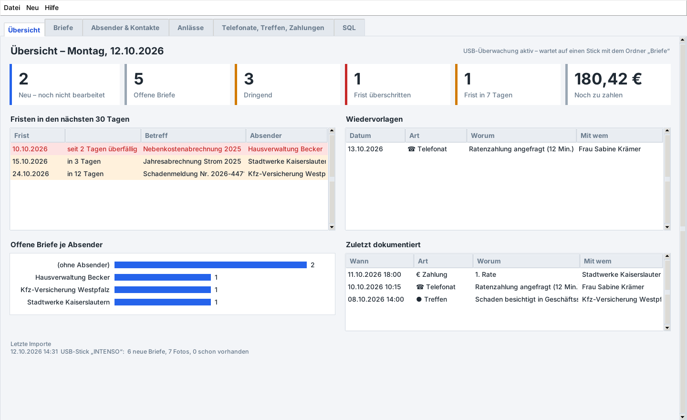
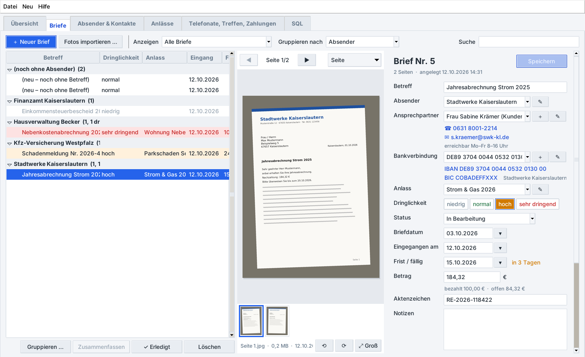
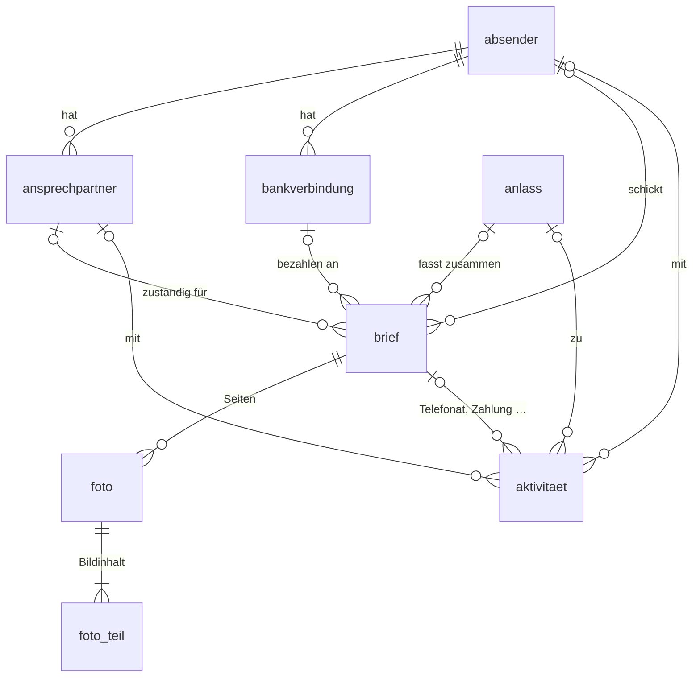

# ✉ Briefverwaltung

Ein Desktop-Programm (Python), das deine Briefe in einer **MySQL-Datenbank** verwaltet. Du fotografierst Briefe mit dem Handy, kopierst die Fotos auf einen USB-Stick in den Ordner `Briefe`, steckst den Stick ein – und die Briefe sind **sofort und von selbst** im Programm.



## Was es kann

- **Automatischer Import vom USB-Stick:** Sobald ein Stick mit dem Ordner `Briefe` steckt, werden alle neuen Fotos in die Datenbank übernommen. Schon importierte Fotos werden erkannt und übersprungen, auf dem Stick wird nichts verändert oder gelöscht.
- **Mehrseitige Briefe:** Ein Unterordner auf dem Stick (z. B. `Briefe/Stromrechnung/`) wird *ein* Brief mit mehreren Seiten. Seiten lassen sich später umsortieren, drehen, abtrennen oder mit „Zusammenfassen“ zu einem Brief vereinen.
- **Leicht eintippen:** Zu jedem Brief Absender, **Ansprechpartner mit Kontaktdaten**, **Bankverbindung** (IBAN wird geprüft), Anlass, **Dringlichkeit** (niedrig, normal, hoch, sehr dringend), Status, Frist, Betrag und Notizen. Neue Absender und Anlässe werden beim Eintippen automatisch angelegt. Datumsfelder verstehen auch `heute`, `morgen`, `+14` (in 14 Tagen) oder `+1m`.
- **Gruppieren nach Absender oder Anlass:** Die Briefliste ordnet nach Absender, Anlass, Dringlichkeit, Status oder Monat. Mehrere Briefe markieren und mit **„Gruppieren …“** auf einmal einem Absender oder Anlass zuordnen.
- **Telefonate, Treffen, Zahlungen & Co. dokumentieren:** E-Mails, verschickte Briefe und Notizen gehören auch dazu, jeweils zu einem Brief, Absender oder Anlass. Bei Telefonaten werden Nummer und Dauer gespeichert, bei Treffen der Ort, bei Zahlungen Betrag, Zahlungsart und Bankverbindung. Eine **Wiedervorlage** erinnert dich an den nächsten Schritt.
- **Übersicht:** Neue, offene und dringende Briefe, überschrittene Fristen, noch zu zahlende Beträge, Wiedervorlagen und offene Briefe je Absender auf einen Blick.
- **SQL-Fenster:** Eigene MySQL-Abfragen schreiben, mit Beispielen und dem Ergebnis als Tabelle. Ergebnisse lassen sich als CSV für Excel speichern.
- **Handy-App für Android:** Briefe und Dokumente mit dem Handy scannen. Die App erkennt den Text, analysiert ihn (Absender, Frist, Betrag, IBAN, Ansprechpartner …) und schickt alles per WLAN an den PC. Einen USB-Stick brauchst du dann nicht mehr ([mehr dazu](#handy-app-android)).



## Schnellstart unter Windows mit XAMPP

1. **MySQL starten:** XAMPP Control Panel öffnen und in der Zeile **MySQL** auf **Start** klicken. Das Feld wird grün und bei Port(s) steht `3306`. Apache brauchst du nicht.
2. **Python installieren:** von [python.org](https://www.python.org/downloads/). Beim Installieren unten **„Add python.exe to PATH“** anhaken.
3. **Programm herunterladen:** auf GitHub **Code → Download ZIP** und die ZIP-Datei entpacken, z. B. nach `C:\Briefverwaltung`.
4. **Pakete installieren:** im entpackten Ordner oben in die Adresszeile `cmd` tippen und Enter drücken, dann:

   ```bat
   py -m pip install -r requirements.txt
   ```

5. **Starten:** Doppelklick auf **`Briefverwaltung starten.pyw`**. Die Voreinstellungen (Server `localhost`, Port 3306, Benutzer `root`, kein Passwort) passen genau zu XAMPP. Das Programm legt die Datenbank `briefverwaltung` beim ersten Start selbst an.
6. **Stick einstecken:** Die Fotos müssen im Ordner `Briefe` direkt auf dem Stick liegen. Wenige Sekunden nach dem Einstecken erscheint unten rechts die Meldung „USB-Import“.

Damit MySQL nicht jedes Mal von Hand gestartet werden muss: im XAMPP Control Panel auf **Config** klicken und unter *Autostart of modules* **MySQL** anhaken.

Startet MySQL in XAMPP nicht, ist meistens Port 3306 schon belegt, z. B. durch eine zweite MySQL-Installation. Beende diese, etwa den Dienst „MySQL80“ unter *Windows → Dienste*, und klicke dann erneut auf **Start**.

Die Datenbank kannst du dir auch in XAMPP ansehen: bei Apache und MySQL auf **Start** klicken, dann bei MySQL auf **Admin**. Dort öffnet sich phpMyAdmin mit der Datenbank `briefverwaltung`.

## Installation

Du brauchst:

1. **Python 3.8 oder neuer** von [python.org](https://www.python.org/downloads/). Unter Windows bei der Installation „Add Python to PATH“ anhaken.
2. **MySQL 8** oder **MariaDB 10.4+**, die einfachste Möglichkeit unter Windows ist [XAMPP](https://www.apachefriends.org/de/) (MariaDB).
3. Die Python-Pakete:

   ```bash
   pip install -r requirements.txt
   ```

   Unter Linux fehlt manchmal tkinter: `sudo apt install python3-tk`.

### Datenbank vorbereiten

| System | So geht's |
|---|---|
| **Windows mit XAMPP** | XAMPP Control Panel öffnen, bei „MySQL“ auf **Start** klicken. Im Programm Benutzer `root`, Passwort leer. Fertig. |
| **Windows mit MySQL** | [MySQL Installer](https://dev.mysql.com/downloads/installer/) ausführen. Du kannst den Root-Benutzer verwenden oder mit [`sql/benutzer_anlegen.sql`](sql/benutzer_anlegen.sql) einen eigenen anlegen. |
| **Linux** | `sudo apt install mysql-server`, dann im Ordner des Programms `sudo mysql < sql/benutzer_anlegen.sql`. Vorher in der Datei das Passwort ändern. Unter Linux darf sich `root` nur per `sudo` anmelden, darum braucht es einen eigenen Benutzer. |

Die Datenbank `briefverwaltung` und alle Tabellen legt das Programm beim ersten Start selbst an.

## Starten

```bash
python briefverwaltung.py
```

Unter Windows geht auch ein Doppelklick auf **`Briefverwaltung starten.pyw`** (ohne schwarzes Konsolenfenster). Klappt die Verbindung mit den Voreinstellungen nicht (`localhost`, Port 3306, Benutzer `root`, kein Passwort, wie bei XAMPP), fragt das Programm nach den Zugangsdaten. Sie stehen danach in `~/.briefverwaltung/einstellungen.json` und lassen sich unter **Datei → Einstellungen** ändern.

## Handy-App (Android)

Mit der App scannst du Briefe und Dokumente direkt mit dem Handy. Die App liest den Text und füllt die Angaben schon aus. Danach schickt sie alles über das WLAN an die Briefverwaltung auf dem PC.

**[⬇ App herunterladen (Briefverwaltung-Handy.apk)](https://github.com/Yourworstdream/Briefverwaltung/releases/download/handy-app/Briefverwaltung-Handy.apk)**

### Installieren und verbinden

1. Den Link oben **auf dem Handy** öffnen und die APK herunterladen.
2. Antippen und installieren. Android fragt einmalig, ob der Browser Apps installieren darf. Das erlaubst du unter „Unbekannte Apps installieren“.
3. Am PC in der Briefverwaltung **Datei → Handy verbinden …** öffnen.
4. In der App oben rechts auf das Zahnrad tippen, dann **QR-Code am PC scannen** wählen.

Handy und PC müssen im **selben WLAN** sein. Windows fragt beim ersten Start, ob Python im Netzwerk erreichbar sein darf. Wähle dort **Zugriff zulassen** für private Netzwerke.

### So funktioniert's

1. **Brief scannen:** Die Kamera findet die Ränder des Blattes, schneidet es gerade und kann mehrere Seiten aufnehmen. Alternativ nimmst du Fotos aus der Galerie oder teilst sie aus einer anderen App an die Briefverwaltung.
2. **Analyse:** Die Texterkennung läuft direkt auf dem Handy, die Fotos werden dafür nirgendwo hochgeladen. Danach erkennt die App:
   - die **Art** (Rechnung, Mahnung, Bescheid, Kündigung, Vertrag, Termin, Werbung …),
   - den **Absender** mit Adresse, Telefon, E-Mail und deiner Kundennummer,
   - den **Ansprechpartner** mit Durchwahl und E-Mail,
   - **Betreff**, **Briefdatum** und **Frist**, auch aus Sätzen wie „innerhalb von 14 Tagen“ oder „innerhalb eines Monats“,
   - den **Betrag**, die **IBAN** (mit Prüfziffer-Kontrolle) und die **BIC**,
   - **Aktenzeichen** bzw. **Rechnungsnummer**,
   - einen Vorschlag für die **Dringlichkeit**, mit Begründung (z. B. „Es ist eine Mahnung“ oder „Die Frist endet in 3 Tagen“).
3. **Prüfen:** Alles steht in Eingabefeldern und lässt sich korrigieren.
4. **An PC senden:** Am PC entsteht ein Brief mit allen Angaben. Absender, Ansprechpartner und Bankverbindung legt das Programm dabei an, falls es sie noch nicht gibt. Der erkannte Text wird mitgespeichert, damit du am PC auch nach Wörtern im Brief suchen kannst.

Ist der PC aus oder nicht erreichbar, wartet der Brief auf dem Handy. Die App schickt ihn beim nächsten Öffnen von selbst. Nach dem Senden löscht sie die großen Fotos auf dem Handy, sie liegen ja jetzt in der Datenbank.

Voraussetzungen: Android 8 oder neuer mit Google-Play-Diensten, die für Scanner und Texterkennung gebraucht werden. Die Daten gehen unverschlüsselt durchs eigene WLAN, geschützt nur durch den Zugangscode. Den Code kannst du am PC jederzeit neu erzeugen.

Die App wird bei jeder Änderung im Ordner `android/` von GitHub Actions neu gebaut. Neue Versionen lassen sich einfach über die alte installieren. Dafür liegt ein fester Signaturschlüssel im Repository (`android/app/briefverwaltung.keystore`). Das ist für den eigenen Gebrauch in Ordnung. Wer die App weitergeben will, sollte einen eigenen Schlüssel anlegen und ihn über die Secrets `ANDROID_KEYSTORE_DATEI`, `ANDROID_KEYSTORE_PASSWORT`, `ANDROID_KEY_ALIAS` und `ANDROID_KEY_PASSWORT` einbinden.

## Briefe vom Handy auf den Stick

```
USB-Stick
└── Briefe/                          ← der Ordner muss direkt auf dem Stick liegen
    ├── IMG_20261008_101500.jpg      ← ein Foto = ein Brief
    ├── Mahnung_Telekom.jpg          ← Dateiname wird zum Betreff („Mahnung Telekom“)
    └── Stromrechnung 2025/          ← ein Unterordner = EIN Brief mit mehreren Seiten
        ├── Seite 1.jpg
        └── Seite 2.jpg
```

- Erlaubt sind JPG, PNG, HEIC (iPhone, mit `pip install pillow-heif`), WEBP, TIFF, BMP, GIF und PDF.
- Der Ordnername (`Briefe`) ist einstellbar, Groß- und Kleinschreibung sind egal.
- Kommt später eine weitere Seite in einen Unterordner, wird sie an den schon importierten Brief angehängt.
- Nach dem Import erscheint unten rechts eine Meldung. Danach kannst du den Stick abziehen. Die neuen Briefe findest du über **„Neue Briefe ansehen“** oder **Anzeigen → Neu**.

### Wie der Stick erkannt wird

Solange das Programm läuft, schaut es alle 2 Sekunden nach neuen Laufwerken, ganz ohne Zusatzprogramme:

- **Windows:** neue Laufwerksbuchstaben (USB-Sticks, SD-Karten, USB-Festplatten)
- **Linux:** eingehängte Wechseldatenträger und alles unter `/media`, `/run/media` und `/mnt`
- **macOS:** alles unter `/Volumes`

Klappt es einmal nicht: **Datei → USB-Stick jetzt prüfen**, oder **Fotos importieren …** und den Ordner von Hand wählen.

### Beim Hochfahren automatisch starten (optional)

- **Windows:** `Win + R` → `shell:startup` → dort eine Verknüpfung zu `Briefverwaltung starten.pyw` anlegen.
- **Linux:** Datei `~/.config/autostart/briefverwaltung.desktop` mit diesem Inhalt anlegen (Pfad anpassen):

  ```ini
  [Desktop Entry]
  Type=Application
  Name=Briefverwaltung
  Exec=python3 /pfad/zu/briefverwaltung/briefverwaltung.py
  ```

Wer nur den Import im Hintergrund möchte, ohne Fenster: `python briefverwaltung.py --waechter`.

## Bedienung

| Reiter | Was du dort machst |
|---|---|
| **Übersicht** | Kennzahlen anklicken öffnet die passenden Briefe. Dazu Fristen, Wiedervorlagen, offene Briefe je Absender und die letzten Importe. |
| **Briefe** | Links die gruppierte Liste, in der Mitte die Fotos (Doppelklick = groß mit Zoom), rechts das Formular. Mehrere Briefe mit Strg/Shift markieren → **Gruppieren …**, **Zusammenfassen**, **Erledigt**. Rechtsklick für Dringlichkeit und Status. |
| **Absender & Kontakte** | Adresse, Kundennummer, **Ansprechpartner** und **Bankverbindungen** pflegen. Dazu alle Briefe und Aktivitäten dieses Absenders. |
| **Anlässe** | Themen wie „Autounfall März 2026“ oder „Nebenkosten 2026“, auch mit Briefen von verschiedenen Absendern. |
| **Telefonate, Treffen, Zahlungen** | Alles Dokumentierte in einer Liste, filterbar nach Art, mit Summe der Zahlungen und Telefonminuten. |
| **SQL** | Eigene Abfragen. Tabellen und Spalten stehen links. Befehle, die etwas ändern (UPDATE, DELETE …), musst du vorher bestätigen. |

Tastenkürzel: `Strg+S` speichern · `Strg+N` neuer Brief · `Strg+F` suchen · `Strg+I` Ordner importieren · `F1` Kurzanleitung · im SQL-Fenster `Strg+Enter` ausführen.

Änderungen an einem Brief werden mit **Speichern** gesichert, und beim Wechsel zu einem anderen Brief speichert das Programm sie automatisch.

## Die Datenbank

Das komplette Schema steht in [`briefe_app/schema.sql`](briefe_app/schema.sql) (ausgeben mit `python briefverwaltung.py --schema`).



| Tabelle | Inhalt |
|---|---|
| `absender` | Behörden, Firmen, Banken, Versicherungen, Privatpersonen … (Name ist eindeutig) |
| `ansprechpartner` | Personen eines Absenders mit Telefon, Mobil, E-Mail, Erreichbarkeit |
| `bankverbindung` | IBAN, BIC, Bank und Kontoinhaber eines Absenders |
| `anlass` | Thema, das Briefe zusammenfasst |
| `brief` | Betreff, Daten, Frist, Dringlichkeit 1–4, Status, Betrag, Aktenzeichen, Notizen |
| `foto` | eine Seite eines Briefes: Dateiname, Größe, Aufnahmedatum, Drehung, kleines Vorschaubild. Ein SHA-256-Wert verhindert doppelte Importe |
| `foto_teil` | der Bildinhalt in Stücken, damit der Import auch mit kleinem `max_allowed_packet` klappt (XAMPP: 1 MB) |
| `aktivitaet` | Telefonate, Treffen, Zahlungen, E-Mails, Notizen, mit Richtung, Dauer, Ort, Betrag, Wiedervorlage |
| `import_protokoll` | wann was von welchem Stick importiert wurde |

Die Sichten **`v_briefe`** (Brief mit Absender, Anlass, Seitenzahl und bereits bezahltem Betrag) und **`v_aktivitaeten`** machen eigene Abfragen einfacher. Beispiele stehen in [`briefe_app/beispiel_abfragen.sql`](briefe_app/beispiel_abfragen.sql) und im SQL-Reiter, zum Beispiel:

```sql
SELECT betreff, absender, betrag, bezahlt, betrag - bezahlt AS offen, frist
FROM v_briefe
WHERE status <> 'erledigt' AND betrag > bezahlt
ORDER BY frist;
```

Fremdschlüssel sorgen für Ordnung. Löschst du einen Brief, verschwinden auch seine Fotos. Löschst du einen Absender, bleiben seine Briefe erhalten, haben dann aber keinen Absender mehr.

### Datensicherung

Alles, auch die Fotos, steckt in der Datenbank. Eine Sicherung ist deshalb eine einzige Datei:

```bash
mysqldump -u briefe -p briefverwaltung > sicherung.sql          # sichern
mysql -u briefe -p briefverwaltung < sicherung.sql              # zurückspielen
```

In XAMPP geht das auch über phpMyAdmin → *Exportieren*.

## Kommandozeile

```bash
python briefverwaltung.py                     # Programm mit Oberfläche
python briefverwaltung.py --import E:\Briefe  # einen Ordner importieren, ohne Oberfläche
python briefverwaltung.py --waechter          # nur USB-Überwachung, ohne Oberfläche
python briefverwaltung.py --schema            # SQL-Schema ausgeben
```

## Tests

```bash
python -m unittest discover -s tests -v
```

Für die Datenbank-Tests wird ein MySQL-Server gebraucht, angegeben über `BRIEFE_TEST_MYSQL=host:port:benutzer:passwort`. Ohne diese Angabe werden sie übersprungen. Jeder Lauf legt eine eigene Test-Datenbank an und löscht sie danach wieder. Auf GitHub laufen alle Tests bei jedem Push automatisch, mit MySQL 8 und mit MariaDB.

Die Brief-Analyse der Handy-App hat eigene Tests. Sie laufen ohne Android SDK, nur mit Java 17:

```bash
cd android
./gradlew -p analyse test
```

## Aufbau

```
briefverwaltung/
├── briefverwaltung.py          Startdatei (Oberfläche oder Kommandozeile)
├── Briefverwaltung starten.pyw Start per Doppelklick unter Windows
├── briefe_app/
│   ├── schema.sql              Tabellen und Sichten (MySQL)
│   ├── beispiel_abfragen.sql   Beispiele für das SQL-Fenster
│   ├── datenbank.py            alle SQL-Zugriffe (nur mit Parametern, sicher gegen SQL-Injection)
│   ├── importer.py             Fotos aus einem Ordner übernehmen
│   ├── usb.py                  USB-Sticks erkennen (Windows, Linux, macOS)
│   ├── bilder.py               Vorschaubilder, Aufnahmedatum, Drehung (Pillow)
│   ├── hilfen.py               Datum, Beträge, IBAN, Auswahllisten
│   ├── konfig.py               Einstellungen laden und speichern
│   ├── empfang.py              Handy-Empfang: nimmt Briefe von der Android-App entgegen
│   └── gui/                    Oberfläche (tkinter)
│       ├── app.py              Hauptfenster, Menü, USB-Überwachung, Import im Hintergrund
│       ├── tab_*.py            die Reiter
│       ├── dialoge.py          Eingabefenster
│       ├── bildanzeige.py      Fotoanzeige mit Zoom
│       └── widgets.py, stil.py Bausteine und Aussehen
├── android/                    Handy-App (Kotlin, Jetpack Compose, Google ML Kit)
│   ├── app/                    Oberfläche, Scanner, Texterkennung, Senden an den PC
│   └── analyse/                Brief-Analyse als reines Kotlin, mit eigenen Tests
├── sql/benutzer_anlegen.sql    eigenen MySQL-Benutzer anlegen
└── tests/                      python -m unittest discover -s tests
```

## Datenschutz

Alles bleibt auf deinem Rechner bzw. in deiner eigenen Datenbank, das Programm schickt nichts ins Internet. Das Datenbank-Passwort steht, wenn du „Passwort merken“ anhakst, in `~/.briefverwaltung/einstellungen.json` (unter Linux und macOS nur für deinen Benutzer lesbar). **Lade keine echten Briefe oder Einstellungen in ein öffentliches Repository hoch.** Die Beispiele und Bildschirmfotos hier sind frei erfunden.
